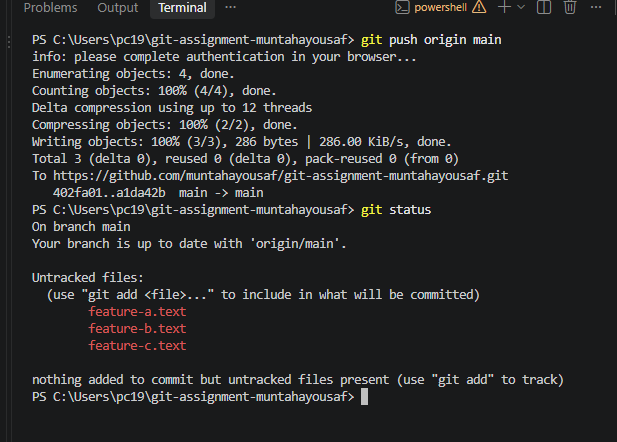
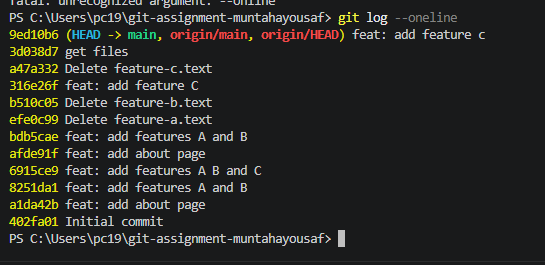
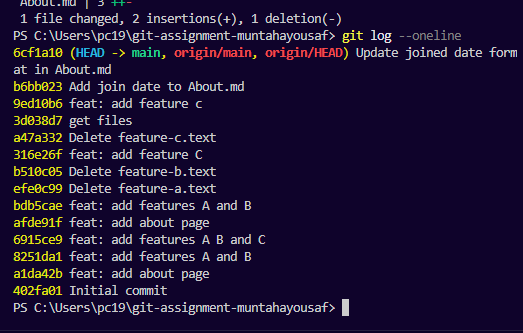
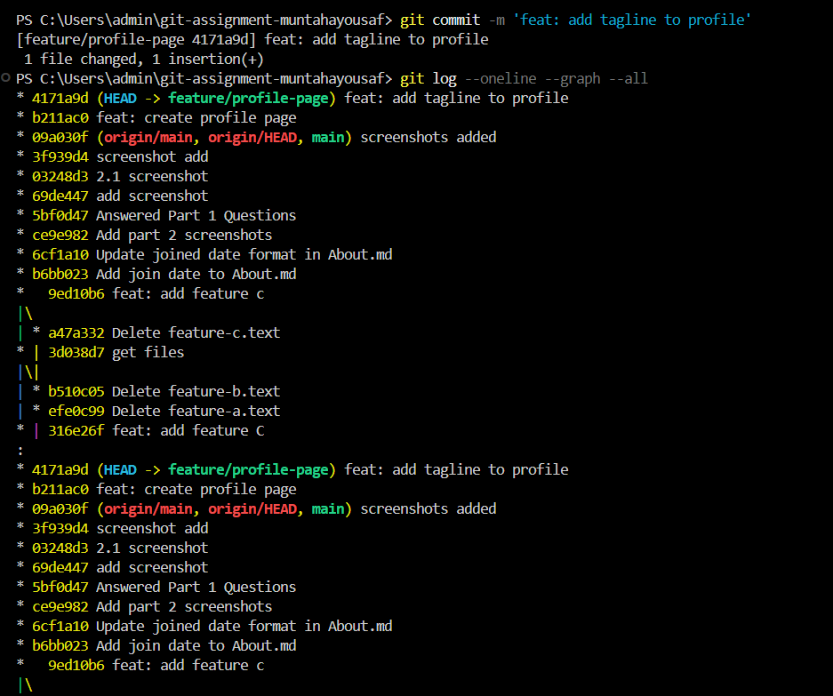
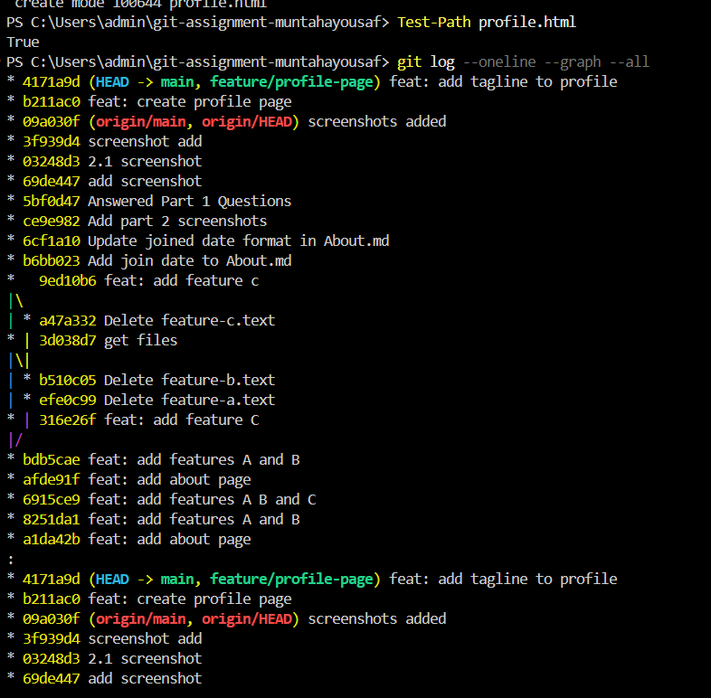
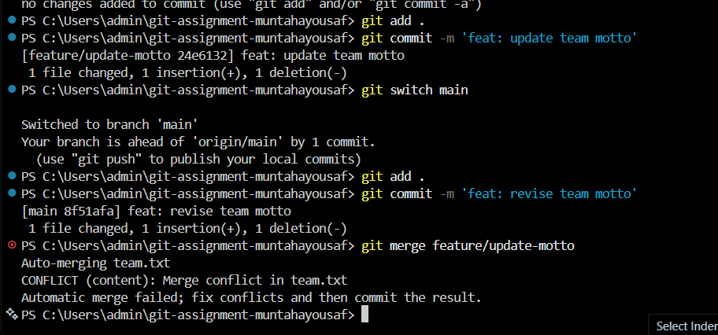
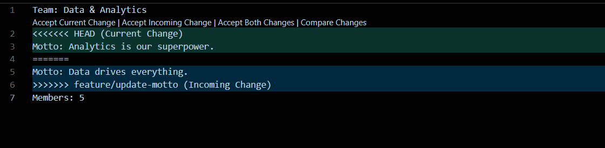
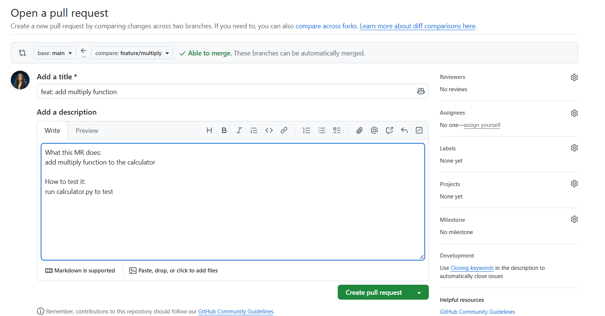
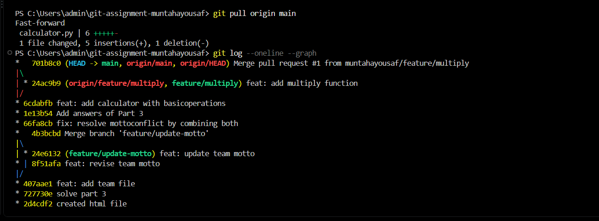

# Git Assignment - Answers

# Q1. Terminal Basics

## 1. What is a terminal? How is it different from clicking through folders in a file explorer?

**Answer.** Terminal is a place where we run commands on pc and pc work based on these commands.
It is different from clicking through folders because in a file explorer we manually create folders or files and manually go into these directory but with terminal we write just commands on terminal instead of doing it manually.

## 2. Write the terminal command to: (a) list all files including hidden ones, (b) create afolder called project, (c) move into that folder.

**Answer.** (a) ls -a this command is use to list all files including hidden
(b) mkdir project 
(c) cd project

## 3. What does the cd ..command do? What about cd ~ ?

**Answer.** cd .. command is use to go one file backward.
cd ~ command is use to go back to home file

--------------------------------------------------

# Q2. Version Control Concepts

## 4. Explain what version control is in your own words. Give one real-world analogy (notGoogle Docs — pick your own).

**Answer.** version control is a system that help developers to manage changes. it is use to track change history . it help to go back to previous version.
Real world Analogy:
for example you have a original excel dataset you clean the file remove duplicates, remove missing values, change formats so version control track all these changes and store history. so you can go back to previous original dataset whenever you need. version control also work like this

## 5. What is the difference between Git and GitHub? Can you use Git without GitHub?

**Answers.** Git is a tool that is use to manage changes track change history. Also use to create commits or projects. it is in our pc.

Github is a cloud based online platform where we can create or store our repositories, pull requests, also we can collaborate with other people.

Yes, i can use git without github because git is a tool in my pc and i can commit changes in my project check history even if i am offline

## 6. Name three features GitHub provides that Git alone does not.

**Answer.** Pull requests, Issues, forks

## 7. What is a repository? What is the difference between a local repository and a remoterepository?

**Answer.** repository is a space where we can store our project files or code. it also store history.
Local repository is in our pc and remote repository is in our server like github

--------------------------------------------------

# Q3. Git internals

## 8. Explain what HEAD means in Git. What happens to HEAD when you switch branches?

**Answer.** HEAD is a pointer in git that point out our current commit. when we switch to branches it it point to the new branch's current commit

## 9. What is a .gitignore file? Write a .gitignore that ignores: all .log files, a foldercalled node_modules/, and any file ending in .env

**Answer.** .gitignore is a file that tells git which files and folders to be ignored

.gitignore file
*.log
node_modules/
*.env

--------------------------------------------------

# Part 2 — Core Commands Lab

# Exercise 2.1 — Your first repo

## 9. Take a screenshot of your GitHub repo showing the commit

# Exercise 2.2 — The staging area

## 2. Run git status. Screenshot the output

## 5. Run git log --oneline.Screenshot

## 6. In answers.md, explain: Why did we commit A+B separately from C? When would youwant to split commits this way?

**Answer.** we commit feature A and B separately from feature C to keep changes organize understandable so we can easily undo , review or fix files whenever needed

# Exercise 2.3 — Push & pull

## 5. Screenshot

## 6. In answers.md , answer: What would happen if you made a local commit first WITHOUTpulling? What command helps you check?

**Answer.** If we are working locally and someone made changes on remote repo so when we commit it first without pulling git may reject it because  the remaote has new changes and our file is not up to date

we can check with git status and git fetch to check if someone made any changes or not

--------------------------------------

# Part 3 — Branching & Merging Lab

# Exercise 3.1 — Branch basics

## 6. Run git log --oneline --graph --all. Screenshot

## 8. Run git log --oneline --graph --all. Screenshot

## 9. Did this merge create a merge commit or was it a fast-forward? Howcan you tell?

**Answer.** it was a fast forward merge. bcz both main and feature/profile-page point to same commit so no separate commit was created

# Exercise 3.2 — Deliberate conflict

## 10. Screenshot the conflict output

## 11. Screenshot the file conflict markers

## 15. In answers.md , answer these:

### a. Why did this conflict happen? (Reference the rule: same file, same line)

**Answer.** this conflict happened bcz of same file same line rule. both branches modified the same line in team.txt file

### b. Would there have been a conflict if the two branches edited different lines of team.txt?

**Answer.** No there would not be a conflict 

### c. Would there have been a conflict if one branch edited team.txt and the otheredited about.md?

**Answer.** No there would not be a conflict. bcz branches are different .

# Part 4 — GitHub Workflow Challenge

# Exercise 4.1 — Feature branch workflow

## 9. Screenshot the PR page

## 12. Screenshot graph merge commit

## 13. In answers.md, answer:

## a. What is the purpose of a pull request? Why not just merge directly?

**Answer.** pull request let others to check our  code and make changes before we merge it to a main branch.

## b. Name two things a reviewer should check in a pull request

**Answer.** 1. checks mistakes and bugs in the code
2. check conflicts and also check the code works correctly or not.

## c. What is the difference between a merge commit and a fast-forward merge?

**Answer.** Merge commit: creates a new commit when we combine two branches.
Fast-Forward commit: does not creates a new commit it moves the branch pointer forward.

# PPart 5 — Merge Conflict Scenarios

# Scenario A.Ahmed creates a branch and changes line 10 of index.html. Sara creates adifferent branch and changes line 1 of the same index.html. Both merge into main. Willthere be a conflict? Why or why not?

**Answer.** No there would be no conflict. Bcz file is same but lines are different and there is a space between two lines. 

# Scenario B. Ali edits style.css on his branch. Fatima edits app.js on her branch. Bothmerge into main. Will there be a conflict? Why or why not?

**Answer.** No there would be no conflict bcz both are working on different files.

# Scenario C. Dev A changes line 5 of config.py to DEBUG = True. Dev B changes line 5 of config.py to DEBUG = False. Both merge into main. Will there be a conflict? If yes,show exactly what the conflict markers would look like in the file.

**Answer.** Yes there would be a conflict bcz both dev working on same files.
<<<<<<<<<<<<<<<<<<<<<<<<<< Head 
DEBUG = FALSE
=================
DEBUG = TRUE >>>>>>>>>>>>>>>>> 

# Scenario D. You run git merge feature/new-ui and see this output: Auto-merging index.htmlCONFLICT (content): Merge conflict in index.htmlAutomatic merge failed; fix conflicts and then commit the result. Write out the exact steps (commands included) you would take to resolve this conflictand finish the merge.

**Answer.**  1. Open index.html file
2. select correct changes and remove conflict markers 
3. save the file
run commands 
git add index.html
git commit -m 'fix conflicts'

# Scenario E. Your teammate says: "I always do git pull before I start working everymorning." Is this a good practice? Explain why or why not, and what could go wrong if theyskip it.

**Answer.** Yeah it is a gud practice to pull before starting work bcz it brings latest code from repo and if we skip it our code would be outdated.

----------------------------------------------------------------------------------