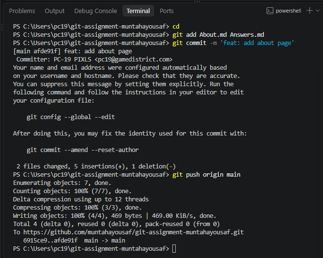

# Git Assignment - Answers

# Q1. Terminal Basics

## 1. What is a terminal? How is it different from clicking through folders in a file explorer?

**Answer.** Terminal is a place where we run commands on pc and pc work based on these commands.
It is different from clicking through folders because in a file explorer we manually create folders or files and manually go into these directory but with terminal we write just commands on terminal instead of doing it manually.

## 2. Write the terminal command to: (a) list all files including hidden ones, (b) create afolder called project, (c) move into that folder.

**Answer.** (a) ls -a this command is use to list all files including hidden
(b) mkdir project 
(c) cd project

## 3. What does the cd ..command do? What about cd ~ ?

**Answer.** cd .. command is use to go one file backward.
cd ~ command is use to go back to home file

--------------------------------------------------

# Q2. Version Control Concepts

## 4. Explain what version control is in your own words. Give one real-world analogy (notGoogle Docs — pick your own).

**Answer.** version control is a system that help developers to manage changes. it is use to track change history . it help to go back to previous version.
Real world Analogy:
for example you have a original excel dataset you clean the file remove duplicates, remove missing values, change formats so version control track all these changes and store history. so you can go back to previous original dataset whenever you need. version control also work like this

## 5. What is the difference between Git and GitHub? Can you use Git without GitHub?

**Answers.** Git is a tool that is use to manage changes track change history. Also use to create commits or projects. it is in our pc.

Github is a cloud based online platform where we can create or store our repositories, pull requests, also we can collaborate with other people.

Yes, i can use git without github because git is a tool in my pc and i can commit changes in my project check history even if i am offline

## 6. Name three features GitHub provides that Git alone does not.

**Answer.** Pull requests, Issues, forks

## 7. What is a repository? What is the difference between a local repository and a remoterepository?

**Answer.** repository is a space where we can store our project files or code. it also store history.
Local repository is in our pc and remote repository is in our server like github

--------------------------------------------------

# Q3. Git internals

## 8. Explain what HEAD means in Git. What happens to HEAD when you switch branches?

**Answer.** HEAD is a pointer in git that point out our current commit. when we switch to branches it it point to the new branch's current commit

## 9. What is a .gitignore file? Write a .gitignore that ignores: all .log files, a foldercalled node_modules/, and any file ending in .env

**Answer.** .gitignore is a file that tells git which files and folders to be ignored

.gitignore file
*.log
node_modules/
*.env

--------------------------------------------------

# Part 2 — Core Commands Lab

# Exercise 2.1 — Your first repo

## 9. Take a screenshot of your GitHub repo showing the commit

